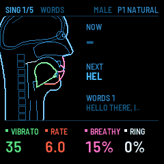
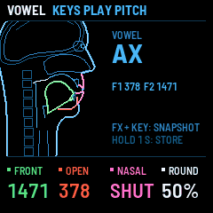
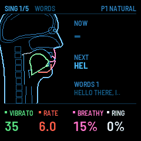

# FM-1 Chimera Vocal

> **A port of [CHIMERA](https://github.com/jamesondh/chimera-vocal-synth) to the M-VAVE FM-1.**
> CHIMERA is a physical-modelling voice synthesizer by **Jameson Hodge**, released under the
> [MIT licence](https://github.com/jamesondh/chimera-vocal-synth/blob/main/LICENSE). The sound
> engine here (the airway model, vocal folds, anatomy, gestures and the text-to-speech front end)
> is a port of his work. Credit for how the voice works belongs to CHIMERA. This project only
> adapts it to small hardware. The name and the flat-view head are used
> [with his permission](https://github.com/jamesondh/chimera-vocal-synth/issues/104#issuecomment-6882133297).
>
> The firmware is built on **[fm1-base](https://github.com/charlesvestal/fm1-base)** by Charles
> Vestal and **[felucca-bsp](https://github.com/hugelton/felucca-bsp)** by Leo Kuroshita
> (@kurogedelic), Hügelton Instruments, which carry code from the FM-1 community firmwares
> **[Felucca](https://github.com/hugelton/Felucca)** (Leo Kuroshita) and
> **[Melodee](https://github.com/keremimo/melodee)** (Kerem Kilic, Ellic Studio), relicensed MPL-2.0 by their authors.
>
> This is an independent, unofficial project, not affiliated with or endorsed by Jameson Hodge, Charles Vestal,
> Hügelton Instruments, Ellic Studio or M-VAVE. "M-VAVE" and "FM-1" are trademarks of their owners.

## Links

- **[The site](https://shan-sherif.github.io/fm-1-chimera-vocal/)**: the front page, with the previews below.
- **[Studio](https://shan-sherif.github.io/fm-1-chimera-vocal/studio/)**: prepare the words, try them on the emulated
  FM-1, send them to yours (Chrome or Edge).
- **[Install](https://shan-sherif.github.io/fm-1-chimera-vocal/install/)**: put the firmware on your FM-1 over USB
  (Chrome or Edge); it can put M-VAVE's own firmware back too.
- **[Manual](https://shan-sherif.github.io/fm-1-chimera-vocal/manual/)**: the keys, buttons, knobs and screens
  ([its source](app/docs/MANUAL.md)).

## What this is

Firmware for the M-VAVE FM-1 that does one thing: a simulated human voice. Every sound comes from a simulated airway
(lungs, vocal folds, throat, mouth and nose), not from samples: CHIMERA's design, kept here.

| WORDS: a syllable a key | VOWEL: the knobs move the mouth | PLAY: speaking the line |
| :---: | :---: | :---: |
|  |  |  |

The firmware's own screen, from the host simulator (`tools/landing_anims.py`).

- **WORDS:** each key sings the next syllable of a line, at the key's pitch, the way CHIMERA's **Sing** mode does in
  the browser: the consonants before the vowel on the press, the vowel while you hold, the consonants after it on the
  release. PLAY speaks the line.
- **VOWEL** (FX): the keys play pitch, and the knobs move the mouth through CHIMERA's vowel space; twelve vowel
  snapshots under FX + a key.
- **The knobs:** five pages of CHIMERA's own controls on K1-K4 (sing, shape, mouth, source, play), the body
  (male, female, child) on ALGORITHM, eight voice presets on PRESET.
- **The screen:** CHIMERA's flat view, live: the head moving as it sings, in CHIMERA's colours.
- **The Studio:** a web page that prepares the words (eight slots) with the CMU Pronouncing Dictionary, lets you try
  them on an emulated FM-1 in the browser, and sends them to yours over USB.
- **Typing on the FM-1:** EDIT opens a word editor, a letter a key (A-Z or QWERTY in two rows), for the same eight
  slots.
- **MIDI in** plays the voice as the keys do, and lights the keys its notes fall on. From a MIDI controller,
  aftertouch deepens the vibrato (as pressing harder on a key does), the **mod wheel** (CC1) adds breath, and
  **pitch bend** bends ±2 semitones ([the manual](app/docs/MANUAL.md#playing-from-a-midi-controller)).

The [manual](app/docs/MANUAL.md) has the keys, buttons and knobs in full.

What isn't ported: CHIMERA's web interface, its 3D heads, the bestiary creatures, the beatbox sequencer, the video
recorder and the browser audio chain. The FM-1 gets its own small interface.

## Status

Working and released: see the [releases](https://github.com/shan-sherif/fm-1-chimera-vocal/releases) for each
version, what changed in it, and its files. The package identity is `FM-1_042` (a release adds its version to it).
CHIMERA's front end, planner and control are ported to C and checked against CHIMERA itself (the lab: identical
gestures). Words come from the Studio or are typed on the FM-1.

## To do

- **Blended bodies:** the three bodies (male, female, child) are CHIMERA's own, precomputed. Bodies in between, like
  CHIMERA's female and child sliders, would blend them as CHIMERA does: the anatomy's four dimensions and the
  calibrated phoneme and vowel targets by weight (`ArticPatch::blend`). The waveguide is the same size for every body,
  so no airway builder is needed and switching costs what it does now. Worth exploring for more varied voices if
  shifting pitch outside the FM-1 (an external pitch or formant shifter) doesn't already give enough variety.
- **Sharper consonants:** a faster anatomy (more of it in RAM, skipped while the tongue is still) so it can run every
  2nd control step (`ANAT_EVERY` in `app/app.c`; every 4th now).
- **The beatbox** (CHIMERA's, on SEQ, with a 2D view).
- **CHIMERA's tunes:** its Sing mode's melodies (Dreamy, Joyful, Somber, Playful, Gentle, Twinkle; `src/song/tunes.ts`),
  with its fitting of the words to them (`src/song/fit.ts`): the FM-1 would sing a word slot on a chosen tune by
  itself (a button held with PLAY, say), in the current preset and body.

## Two cores

The voice uses both of the FM-1's processor cores (fm1-base's second-core jobs, from Melodee). Each audio block
(256 samples, 5.8 ms):

- **Core 2** renders the sound for this block: the waveguide tract (`engine/ch_wave.c`: the pressure waves in the
  throat, mouth and nose), CHIMERA's vocal folds and its noise sources, every sample.
- **Core 1** meanwhile computes the next block's control: CHIMERA's articulators and gestural score
  (`engine/ch_control.c`) and its anatomy (`engine/ch_tract.c`, every 4th control step, the tract gliding between),
  and between blocks the screen and the words (`engine/ch_speech.c`, `engine/ch_live.c`).

Measured on the FM-1: both cores and the audio load under 60 % of a block while it sings and speaks (0.1.x), no
dropouts. If the second core fails to start, the voice falls back to one core (`cpu2_fallback`).

CHIMERA's full airway physics ran on the FM-1 but at about twice what it can afford
([docs/full-physics-on-fm1.md](docs/full-physics-on-fm1.md): the measurements, and what someone could
try to make it fit). The voice keeps CHIMERA's anatomy, vocal folds, calibrated shapes and noise sources and drives a
waveguide tract instead. Against CHIMERA's own renders it is about 5.4 dB in spectrum (the full physics port: 1.2).

## The newer FM-1 flash chip

FM-1s sold since autumn 2026 (mostly on AliExpress) carry a UC25HQ80 flash chip (JEDEC ID `0xB36014`) in place of the
stock Puya P25Q80 (`0x856014`). Both hold 1 MB and take the same standard SPI flash commands, so the same flash code
works on both. What differed was only a safety check: at power-on the firmware asks the chip for its ID and uses the
flash only if it knows the answer. A firmware that knew only the Puya treated a newer unit as unknown: nothing was
saved to flash, and updates were refused.

This firmware accepts both chips (any other is still refused): the same fix Felucca made in
[`f4cbb6a`](https://github.com/hugelton/Felucca/commit/f4cbb6a2a0a35e068d4f063083d464eb4dbaa415)
([issue #320](https://github.com/hugelton/Felucca/issues/320)) and SLOOP in
[`bac9c05`](https://github.com/isod89/sloop-fm1/commit/bac9c05ea7627449405aa10e48da21d75b6c8c56). Here it comes from
fm1-base, which this firmware is built on: Laurens's (@profikid) `device/fm1_flash_ok.h`, fm1-base PR #35 (`e75b072`). It
has not yet been tested with this firmware on a newer unit: if you have one, a report is welcome (saving words in the
Studio, SAVE on a preset, then a power cycle).

## Layout

| Path | What |
| --- | --- |
| `engine/` | The C port of CHIMERA's voice (MIT, Jameson Hodge's notice kept): `ch_voice.c` the literal audio rate (the reference), `ch_fast.c` the same rearranged for the FM-1 (the full-physics attempt), `ch_tract.c` the anatomy, `ch_wave.c` the FM-1's waveguide tract, `ch_control.c` the control rate (articulators, gestural score, source, contacts), `ch_speech.c` the English front end, planner and vowel pad (with `ch_phon_data.h`, generated from CHIMERA's tables, and `ch_dict_data.h`, ~480 CMUdict words), `ch_live.c` live singing, `ch_profile.c` the flat view's outlines, `ch_common.h` / `ch_str.h` what they share |
| `app/` | The firmware, on fm1-base (started from its template): `app.c` (the voice on two cores, the words, the word editor, the pages, VOWEL, the presets, the screens), `app.h`, `fm1.toml`; `dsp/voice_bodies.h` (CHIMERA's three bodies, male, female and child: their anatomy settings, speaking pitch and vowel ranges), `dsp/voice_male.h` (the male airway's full layout, for the lab's full-physics test), `dsp/words_default.h` (CHIMERA's presets as the first word slots); `web/studio.html` the Studio; `site/landing.md` the front page; `docs/MANUAL.md` and its screenshots; `tests/` the simulator's scripts |
| `tools/` | `make_site.py` (the site: fm1-base's, plus the Studio, the emulator, CHIMERA's colours, the credits, the licence texts), `manual_shots.sh` (the manual's screenshots from the simulator) |
| `lab/` | The test bench: CHIMERA itself as a Rust library, the recorder, the C replay checks, the front end's checks, comparisons, cost estimates, the table generators |
| `base/` | [fm1-base](https://github.com/charlesvestal/fm1-base) by Charles Vestal (MPL-2.0), with felucca-bsp in `base/bsp/`: plain folders, copied from upstream ([Based on fm1-base](#based-on-fm1-base)) |
| `docs/` | `full-physics-on-fm1.md`: CHIMERA's full airway on the FM-1, measured, for whoever optimises it |
| `LICENSE`, `LICENSES/` | Which licence covers which files, and the full texts |

## Based on fm1-base

The platform under the app, copied into this repository on 2026-11-16 (a git submodule until then), so it can
be changed here. Its files keep their MPL-2.0 headers and their authors' notices (`base/LICENSE`, `base/LICENSING.md`,
`base/CREDITS.md`); changes made here to them are MPL-2.0 too. What this firmware does not use was left out: fm1-base's
`template/`, `examples/` and `skill/`, felucca-bsp's `examples/`, and their GitHub workflows. Upstream fixes are carried
over by hand, against these commits:

| Here | From | Commit |
| --- | --- | --- |
| `base/` (but `base/bsp/`) | [charlesvestal/fm1-base](https://github.com/charlesvestal/fm1-base) | `c8e0599` |
| `base/bsp/` | [hugelton/felucca-bsp](https://github.com/hugelton/felucca-bsp) | `18eadad` |

## Building

The JieLi toolchain in `~/.jieli/toolchain`, the AC79 SDK in `~/fw-AC79_AIoT_SDK`, Docker on macOS (Colima),
Python with Pillow and fontTools (`python3 -m venv .venv && .venv/bin/pip install Pillow fonttools`), and for the
browser emulator Emscripten (`emcc` on PATH, or `~/emsdk`):

    .venv/bin/python base/tools/build.py app --host       # the simulator: app/build/host/chimera_host
    app/build/host/chimera_host app/tests/pages.txt app/build/host
    JIELI_TOOLCHAIN=~/.jieli/toolchain .venv/bin/python base/tools/build.py app --sdk ~/fw-AC79_AIoT_SDK
                                                         # the FM-1: app/build/chimera.fwsc, identity FM-1_04200

The site, with the web installer, the Studio and the emulator (Chrome or Edge, the FM-1 on USB):

    .venv/bin/python tools/make_site.py                # the release (fm1.toml's version), the emulator, app/build/site
    python3 -m http.server 8042 --bind 127.0.0.1 --directory app/build/site
                                                         # open http://127.0.0.1:8042/

It is fm1-base's site (`base/tools/make_site.py`) with CHIMERA's credit at the top of each page, the Studio
(`studio/`, with CHIMERA's copy of CMUdict beside it) and the emulator (`emu/`, embedded in the Studio), in CHIMERA's
colours, with the licence texts beside the package. The pages count visits with
[GoatCounter](https://www.goatcounter.com/) (no cookies, no personal data; local previews
are not counted). The firmware build runs the toolchain in Docker, which now and then crashes with nothing wrong in the
build; the site build tries it up to three times. `sh tools/manual_shots.sh` retakes the manual's screenshots,
`.venv/bin/python tools/landing_anims.py` the front page's animated previews (`app/site/img/`).

On GitHub, `.github/workflows/pages.yml` builds the same site on every push to `main` (JieLi's toolchain, the AC79 SDK
from gitee, Emscripten, CHIMERA's dictionary at a fixed commit) and deploys it to GitHub Pages; the release is the
`version` line in `app/fm1.toml`.

The simulator's tests (`app/tests/`): `silence`, `rest`, `words`, `pages`, `screens`, `studio` (the Studio's SysEx),
`edit` (the word editor), `bodies` (male, female, child), `expression` (pressure, aftertouch, mod wheel, pitch bend),
`crack` (no crack where a nasal ends a word),
`stress` (three minutes of random playing).

## The lab

- `cargo run --release -- rates "Text." [male|female|child]` runs CHIMERA itself at the cut-down
  settings and compares it with the original; `-- nodes` lists the airway sizes.
- `cargo run --release -- record "Text." [body]` records CHIMERA's voice at 44.1 kHz with its
  control-rate output and its articulation (`sh patch-chimera.sh` first: it makes the fields the
  recorder reads public, nothing else).
- `sh port/build.sh`, then `out/replay64 out/male.rec` checks the literal port against CHIMERA,
  `out/replay_fm1 out/male.rec out.wav --tract=out/male.art --drive --fast=16` runs the FM-1's version
  (its maths, the head model in C, geometry every 16 samples), `--anat-every=N` the head model every
  N control steps. `--control=out/male.gst` (with `--tract`) runs the C control from CHIMERA's gestures, checks each
  step's articulation, vocal-fold settings and breath against the recording, and renders through the waveguide.
- `cargo run --release -- compare ref.wav other.wav[@shift]` compares level and spectrum frame by frame;
  `-- timeline ref.wav other.wav` frame by frame; `-- psupra FROM TO` CHIMERA's pressure above the glottis.
- `tools/pi_cost.py` estimates per-sample instruction counts from the FM-1 compiler's assembly.
- `tools/gen_voice_header.py out/male.rec out/male.art > ../app/dsp/voice_male.h` makes the male airway's header;
  `tools/gen_bodies_header.py out/male.art out/female.art out/child.art > ../app/dsp/voice_bodies.h` the three bodies'
  (after `lab record "..." female` and `child`); `lab phonemes > ../engine/ch_phon_data.h` each body's calibrated
  phonemes and vowels.
- `cargo run --release -- phonemes > ../engine/ch_phon_data.h` writes CHIMERA's phoneme and vowel tables;
  `tools/gen_dict.py tools/common_words.txt ../external/chimera-vocal-synth/public/data/cmudict.txt.gz > ../engine/ch_dict_data.h`
  the built-in pronunciations; `tools/gen_words_default.py` the first word slots (`app/dsp/words_default.h`);
  `tools/gen_random_words.py` the Studio's random words (`app/web/random_words.txt`, from SCOWL's release).
- `cargo run --release -- fronttest`, then `out/front_test` (and `out/front_test_fm1`, the FM-1's maths) checks the C
  front end against CHIMERA's: the letter-to-sound rules on every dictionary word, texts to phrases to gestures,
  lyrics to syllables, live note on/off.
- `node port/studio_test.mjs ../app/web/studio.html ../external/chimera-vocal-synth/public/data/cmudict.txt.gz ../engine/ch_dict_data.h out`
  runs the Studio's own code on test lines; `out/studio_check out/doc.txt` must then print `out/studio_syl.txt` (the
  firmware sings the syllables the Studio shows).
- `node port/emu_test.mjs ../app/build/site/emu/app.wasm` drives the emulator as its worklet does, with the Studio's
  SysEx: hello, a document, "sing and speak slot", and checks a voice comes out.

The reference sources are cloned into `external/` (gitignored): CHIMERA, Felucca, Saadet, Melodee,
fm-1-midi-mania and fm1-base. Of these only CHIMERA's code is ported here; the others were read for reference.

## Licence

See [LICENSE](LICENSE): the port of CHIMERA's voice (`engine/`, `app/dsp/voice_male.h`, `app/dsp/voice_bodies.h`) is MIT, keeping Jameson
Hodge's copyright; the files started from fm1-base's template (`app/app.c`, `app/app.h`) are MPL-2.0; this project's own
files (the Studio, the site, the tools, the lab) are MIT, Shan-Sherif; the CMUdict entries are under CMU's BSD-style
licence; the Studio's random words (`app/web/random_words.txt`) are from SCOWL, under its permissive notice. The full texts are in [LICENSES/](LICENSES/). The firmware package is MPL-2.0 AND MIT, with the JieLi SDK's
files under Apache-2.0.

## Credits

- **CHIMERA** by Jameson Hodge (MIT): the voice model and everything it sounds like.
  <https://github.com/jamesondh/chimera-vocal-synth>. CHIMERA's own references (Ishizaka, French &
  Flanagan 1975; Hillenbrand et al. 1995; Klatt 1979; and others) are listed in its
  [architecture notes](https://github.com/jamesondh/chimera-vocal-synth/blob/main/docs/architecture.md#references-and-credits).
  The name and the flat-view head with his permission
  ([#104](https://github.com/jamesondh/chimera-vocal-synth/issues/104#issuecomment-6882133297)).
- **fm1-base** by Charles Vestal (MPL-2.0): the firmware's platform, build, installer and emulator.
- **felucca-bsp** and **Felucca** by Leo Kuroshita, Hügelton Instruments: the FM-1's hardware layer and much of
  fm1-base, his code relicensed MPL-2.0 with his permission
  ([felucca-bsp#4](https://github.com/hugelton/felucca-bsp/issues/4)).
- **Melodee** by Kerem Kilic (Ellic Studio): the second core's jobs, the MIDI clock and the packed boot images in
  fm1-base and felucca-bsp, relicensed MPL-2.0 with his permission.
- **Laurens** (@profikid): the newer flash chip's support in fm1-base (PR #35); the same fix as Felucca's and SLOOP's.
- **Chris Farrell** ([fm-static](https://github.com/seajaysec/fm-static)): parts of the web installer's update code in
  fm1-base (`web/fm1ota.js`, `web/fm1pkg.js`: finding the FM-1 under any port name, M-VAVE's Open firmware, the
  resume's return check), relicensed MPL-2.0 with his permission
  ([seajaysec/fm-static#1](https://github.com/seajaysec/fm-static/issues/1)).
- **Saadet** (Kerem Kilic, Ellic Studio) and **Midi-Mania** (Shan-Sherif): FM-1 firmwares studied for this port.
- **CMU Pronouncing Dictionary**, Carnegie Mellon University (BSD-style): the ~480 built-in pronunciations
  (`engine/ch_dict_data.h`) and the Studio's dictionary.
- **SCOWL** (Spell Checker Oriented Word Lists), Kevin Atkinson, from the public-domain Moby Words and Brian Kelk's
  frequency list ([LICENSES/SCOWL.txt](LICENSES/SCOWL.txt)): the everyday words the Studio's Random picks from.
- **Barlow** (The Barlow Project Authors, SIL OFL 1.1): the screen's fonts, through fm1-base.
