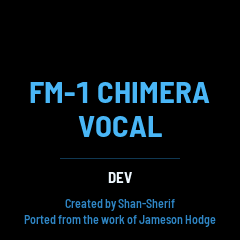
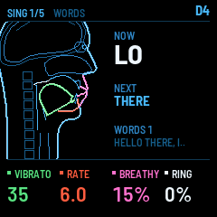
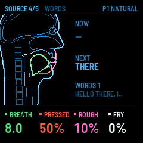
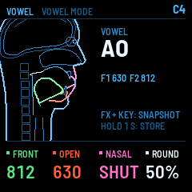

# CHIMERA

**A port of [CHIMERA](https://github.com/jamesondh/chimera-vocal-synth) by Jameson Hodge (MIT) to the M-VAVE FM-1**,
on [fm1-base](https://github.com/charlesvestal/fm1-base) by Charles Vestal. The voice is CHIMERA's: a simulated
airway (lungs, vocal folds, throat, mouth and nose), not samples.

FM-1 Chimera Vocal sings words: each key sings the next syllable of a line, at the key's pitch, through CHIMERA's own
text-to-speech front end. In VOWEL mode the keys play pitch and the knobs move the mouth through the vowels. The screen
is CHIMERA's flat view, live: the head moving as it sings.

## The keys

- **WORDS** (the start, and HOME): each key sings the next syllable of the word slot: the consonants before the vowel
  when you press, the vowel for as long as you hold, the consonants after it when you let go. Press the next key
  before letting go of the last and the two syllables join (legato). Harder presses breathe harder. After the last
  syllable it starts again.
- **VOWEL** (FX): the keys play pitch only, the voice holding the vowel the knobs set; the last key held sounds, the
  pitch gliding (Glide) between keys.
- MIDI in plays as the keys do. **OCT− / OCT+** move the keys an octave. About 50 ms after the sound dies away the
  voice rests (nothing is simulated, the output is silent).

## The buttons

| Button | What it does |
| --- | --- |
| HOME | WORDS mode, page 1 (SING). |
| FX | VOWEL mode and back (a quick press). Held with a key 1-12: that vowel snapshot (below). Its light is on in VOWEL mode. |
| EDIT | The next of pages 2-5. |
| PLAY | Speaks the word slot's words (in WORDS mode). Pressing a key while it speaks starts singing instead. |
| SAVE | Keeps the knobs in the voice preset, the vowel snapshots and the settings, through power-off. Its light is on while something is unsaved. |
| GLO | The debug page (the cores' timings) and back. |

## The knobs

**K1-K4** are the page's four values, shown at the bottom of the screen in their colours (K1 green, K2 red, K3 pink,
K4 white). **SELECT** turns the page. The ranges are CHIMERA's own.

| Page | K1 | K2 | K3 | K4 |
| --- | --- | --- | --- | --- |
| 1 SING | Vibrato (cents, sung notes) | Rate (vibrato, Hz) | Breathy | Ring (the singer's ring, near 3 kHz) |
| 2 SHAPE | Jaw (opening, cm) | Lips (opening, cm) | Larynx (up / down, cm) | Palate (the soft palate: SHUT, or the nose's opening, cm²) |
| 3 MOUTH | Round (the lips' rounding) | Protrude (the lips, cm) | Root (the tongue root, cm) | Curl (the tongue tip's) |
| 4 SOURCE | Breath (the lungs' pressure, cmH₂O) | Pressed (the vocal folds) | Rough | Fry |
| 5 PLAY | Glide (pitch, ms) | Speed (PLAY's speech, ×) | F.Folds (the false folds) | Body (adult male; more to come) |
| VOWEL | Front (← front, back →: F2, Hz) | Open (close → open: F1, Hz) | Nasal (the soft palate) | Round |

**ALGORITHM** is Bright, on every page. The shaping knobs (pages 2 and 3) set the voice's posture, as CHIMERA's do:
they shape the held vowels and the voice between words; while it sings words, the words' own movements lead.

**VOWEL** is CHIMERA's vowel pad: Front and Open choose a place among the vowels (by their formants, F1 and F2), and
the voice blends the four calibrated vowels nearest it. The screen names the vowel made (in ARPAbet's letters: AA as
in "father", IY "see", UW "you", AE "cat", AX the neutral schwa).

**Vowel snapshots:** hold FX and press one of the first twelve keys to jump to that vowel (they start as twelve
English vowels: IY IH EY EH AE AA AO OW UH UW AH AX). Hold the key a second, with FX, to store the vowel you have
made there instead. SAVE keeps them.

## Presets and word slots

- **PRESET** chooses one of eight voice presets, loaded when the knob rests: NATURAL, BREATHY, BELT, OPERA, AIRY,
  ROUGH, FRY, TWANG (this port's own: CHIMERA has none). SAVE stores the knobs as they are into the preset chosen.
- **HOME + PRESET** (turn PRESET with HOME held) chooses the word slot the keys sing, 1-8, as the Studio sent them.
  The screen shows the slot and how it starts.

## What the screen shows

At the top: the page (SING 1/5 ... or VOWEL), the mode, the preset; the note while one sounds. The head, side on,
moving as it sings: the tongue green, the jaw red, the lips pink, the soft palate white. Beside it in WORDS: NOW, the
syllable sounding (a hyphen when its word goes on; SPEAKING while PLAY speaks), NEXT, the one the next key sings, and
the word slot; in VOWEL: the vowel made and its formants. At the bottom: the page's four knobs.

**GLO** switches to the debug page and back: how long each core takes.

| Line | What it means |
| --- | --- |
| CORE 2 TRACT | The second core's share of each audio block (5.8 ms): the sound waves through the throat, mouth and nose, and the vocal folds, every sample. The average over the last half second, then the worst block. |
| CORE 1 CONTROL | The first core's share: moving the articulators along the gestures, then turning the tongue, jaw and lip positions into the shape of the tract. |
| AUDIO LOAD | The whole audio interrupt's share of its time. |
| XRUNS | Blocks that were late since power-on: each is a click. It should stay at 0. |
| TWO CORES / ONE CORE | Whether the second core is running. If it fails, the voice continues on one core. |

Anything under 100 % fits. The anatomy (the tongue, jaw and lip positions turned into the tract's shape) runs every
4th control step, the tract gliding between: more often overloads the FM-1 while it speaks.

## The Studio: your words

Open the site's **Studio** page in Chrome or Edge. On the left is an emulated FM-1 (the same firmware, in the
browser): press its **START**, then **Play** on a slot speaks that line there, and the emulator's keys sing it. On the
right are the eight slots, starting with CHIMERA's presets; each shows its syllables (one key each) and every word's
pronunciation from the CMU Pronouncing Dictionary. A word it does not know (a name, a made-up word) gets a box: say how
it sounds with words it knows ("kai mirror" for Chimera).

With your FM-1 on USB, **Connect** loads the slots it holds. **Send to FM-1** on a slot puts that line on it (its other
slots stay); **Update all slots** sends all eight. The FM-1 says "WORDS RECEIVED", keeps them through power-off and
sings the slot. A slot's badge says whether your FM-1 has it as shown. **Read from FM-1** brings back what it holds;
**Save file** / **Load file** keep sets of words on the computer.

## How the words are read

CHIMERA reads English with the CMU Pronouncing Dictionary (134,000 words), which does not fit in the FM-1. The
firmware knows the pronunciations of about 480 common words; others are read by spelling rules: CHIMERA's, plus a few
of this port's for doubled letters, plural and past-tense endings and the like. The rules get most words close but not
all exact, so an unusual word can come out oddly. Words sent from the Studio come with the dictionary's pronunciations,
so those are exact.
