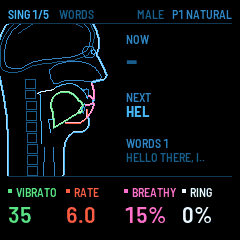
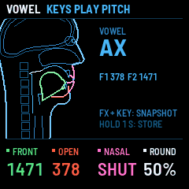
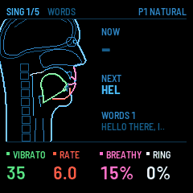

# CHIMERA

**A port of [CHIMERA](https://github.com/jamesondh/chimera-vocal-synth) to the M-VAVE FM-1.** CHIMERA is a
physical-modelling voice synthesizer by **Jameson Hodge**, released under the MIT licence: lungs, vocal folds, throat,
mouth and nose, simulated. How the voice works is his. This firmware only adapts it to the FM-1. It's built on
[fm1-base](https://github.com/charlesvestal/fm1-base) by Charles Vestal and
[felucca-bsp](https://github.com/hugelton/felucca-bsp) by Leo Kuroshita, Hügelton Instruments.

This is version {{VERSION}} of FM-1 Chimera Vocal. The FM-1 sings words: each key sings the next syllable of a line, at the key's pitch, and
PLAY speaks the line. ALGORITHM chooses CHIMERA's male, female or child body, each with its own airway and its own
vowels. The screen is CHIMERA's flat view, the head moving as it sings. Every sound comes from the
simulated airway, not from samples.

The voice uses both of the FM-1's processor cores: the second core simulates the sound waves in the throat, mouth and
nose and the vocal folds, every sample; the first runs CHIMERA's control (the tongue, jaw and lips moving along the
words' gestures, and the anatomy that turns them into the tract's shape) and the screen. CHIMERA's full airflow
simulation is about twice what the FM-1 can run, so the tract is a lighter waveguide driven by CHIMERA's anatomy,
vocal folds and noise sources.

You install it at your own risk, and the installer can put M-VAVE's own firmware back.

It works with both FM-1 flash chips, the older Puya P25Q80 (`0x856014`) and the newer UC25HQ80 (`0xB36014`): the
same fix as [Felucca's](https://github.com/hugelton/Felucca/commit/f4cbb6a2a0a35e068d4f063083d464eb4dbaa415)
([#320](https://github.com/hugelton/Felucca/issues/320)) and
[SLOOP's](https://github.com/isod89/sloop-fm1/commit/bac9c05ea7627449405aa10e48da21d75b6c8c56), here from fm1-base
(Laurens, PR #35). Not yet tested with this firmware on a newer unit.

- The [Studio](studio/) prepares the words the FM-1 sings, with the CMU Pronouncing Dictionary, lets you try them on
  an emulated FM-1 in the browser, and sends them to yours over USB. You can also type them on the FM-1 itself: EDIT
  opens the word editor, a letter a key.
- [Install](install/) it from Chrome or Edge, with the FM-1 connected by USB.
- The [Manual](manual/) explains the keys, the knobs and the screen.
- The [Source](https://github.com/shan-sherif/fm-1-chimera-vocal): the voice's port is MIT (CHIMERA's licence), the
  firmware's platform MPL-2.0 (fm1-base's).

These pages count visits with [GoatCounter](https://www.goatcounter.com/): no cookies, no personal data.

Unofficial: not affiliated with or endorsed by M-VAVE, Jameson Hodge or fm1-base's authors. M-VAVE and FM-1 are
trademarks of their owners.
